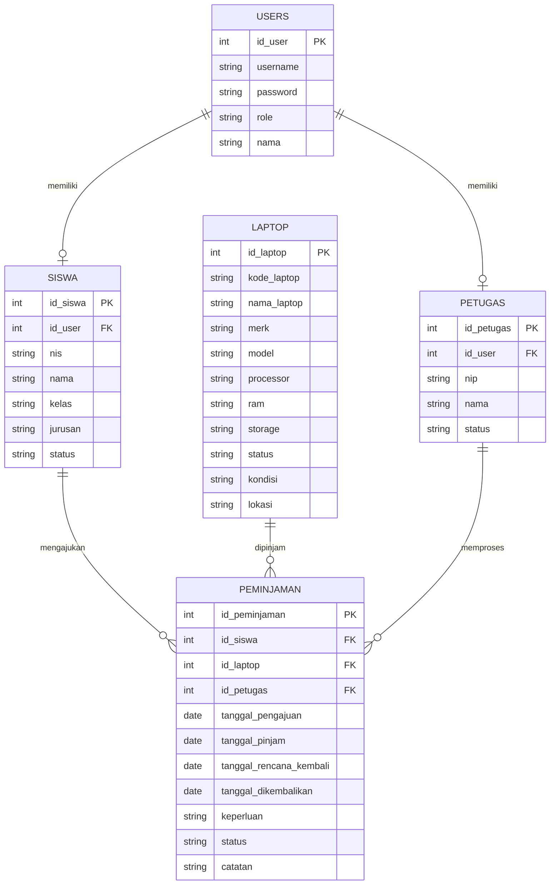

# ERD Konseptual

Entitas utama yang dapat digunakan untuk dokumentasi ERD jobsheet:

Catatan: ERD ini adalah rancangan dokumentasi. Implementasi prototype menggunakan LocalStorage, bukan database SQL.
